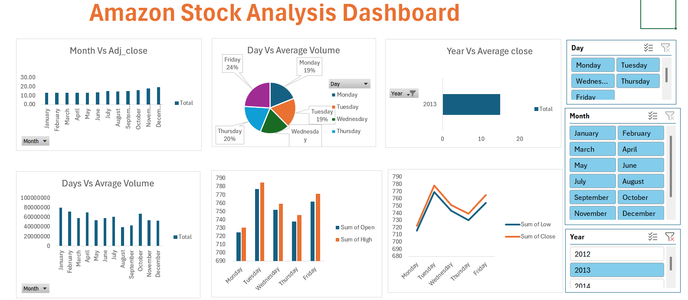

# Amazon-Stock-Analysis
This Excel dashboard analyzes Amazon stock data from 2012 to 2014. It shows monthly adjusted closing prices, average trading volume, yearly closing prices, and daily stock performance. Interactive slicers for day, month, and year help users filter data, identify trends, and understand stock market performance for better decision-making.

